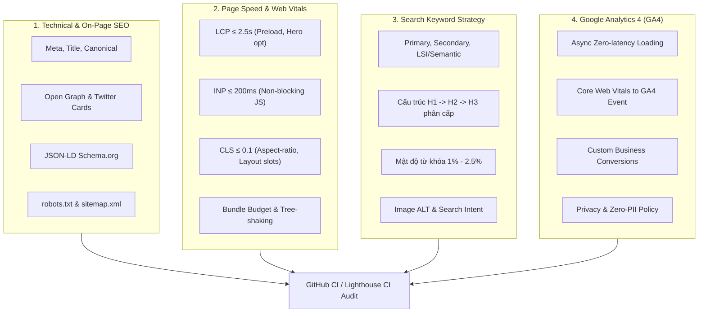

# SEO, Page Speed, Keywords & Analytics Standardization Skill

Quy chuẩn toàn diện về Tối ưu hóa Công cụ tìm kiếm (Technical & On-Page SEO), Tốc độ tải trang & Core Web Vitals (Page Speed), Ma trận Từ khóa tìm kiếm (Keyword Strategy) và Đo lường Google Analytics 4 (GA4) tự động hóa qua GitHub Actions CI.

---

## 1. Bốn Trụ Cột Chuẩn Hóa (The 4 Pillars)



---

## 2. Trụ Cột 1: Chuẩn Hóa SEO Kỹ Thuật (Technical & On-Page SEO)

### 2.1. Thẻ Meta & Cấu trúc Head bắt buộc
Mỗi trang web phải đáp ứng các thẻ chuẩn sau trong `<head>`:

```html
<!-- Tiêu đề: Tối đa 60 ký tự, đưa từ khóa chính lên đầu -->
<title>[Từ khóa chính] - [Mô tả giá trị cốt lõi] | [Tên Thương Hiệu]</title>

<!-- Meta Description: 150-160 ký tự, chứa từ khóa chính, từ khóa phụ và Call-to-Action -->
<meta name="description" content="[Mô tả hấp dẫn chứa từ khóa chính và lợi ích vượt trội. Kèm lời kêu gọi trải nghiệm ngay.]" />

<!-- Canonical URL: Ngăn trùng lặp nội dung -->
<link rel="canonical" href="https://yourdomain.com/" />

<!-- Robots Indexing -->
<meta name="robots" content="index, follow, max-image-preview:large, max-snippet:-1, max-video-preview:-1" />

<!-- Viewport & Theme Color -->
<meta name="viewport" content="width=device-width, initial-scale=1.0" />
<meta name="theme-color" content="#0f0f10" />
```

### 2.2. Social Sharing: Open Graph (OG) & Twitter Cards
- **OG Image chuẩn**: Kích thước bắt buộc **1200 x 630 px** (tỷ lệ 1.91:1), dung lượng `< 200 KB`, định dạng PNG/WebP tối ưu.
- **Thẻ Open Graph**:
  ```html
  <meta property="og:site_name" content="Tên Thương Hiệu" />
  <meta property="og:type" content="website" />
  <meta property="og:url" content="https://yourdomain.com/" />
  <meta property="og:title" content="Tiêu đề hấp dẫn trên mạng xã hội" />
  <meta property="og:description" content="Mô tả súc tích giải quyết vấn đề của người dùng." />
  <meta property="og:image" content="https://yourdomain.com/og-image.png" />
  <meta property="og:image:width" content="1200" />
  <meta property="og:image:height" content="630" />
  <meta property="og:locale" content="vi_VN" />
  <meta property="og:locale:alternate" content="en_US" />
  <meta property="og:locale:alternate" content="ja_JP" />
  ```
- **Thẻ Twitter Card**:
  ```html
  <meta name="twitter:card" content="summary_large_image" />
  <meta name="twitter:site" content="@yourbrand" />
  <meta name="twitter:title" content="Tiêu đề Twitter" />
  <meta name="twitter:description" content="Mô tả ngắn gọn" />
  <meta name="twitter:image" content="https://yourdomain.com/og-image.png" />
  ```

### 2.3. Cấu trúc dữ liệu có cấu trúc (JSON-LD Schema)
Nhúng Schema Graph chuẩn của Google để tăng tỷ lệ hiển thị Rich Snippets:
- `Organization`: Định danh công ty, logo, hotline, ngôn ngữ hỗ trợ.
- `WebSite`: Định danh website, tìm kiếm nội bộ (SearchAction).
- `SoftwareApplication` / `Product`: Giá cả, phân loại ứng dụng, tính năng nổi bật.
- `FAQPage`: Hiển thị danh sách câu hỏi thường gặp ngay trên kết quả tìm kiếm Google.

### 2.4. `robots.txt` & `sitemap.xml`
- **robots.txt**:
  - Cho phép bot crawl trang chủ, landing page, bảng giá, FAQ.
  - **Chặn (Disallow)** toàn bộ phòng họp riêng tư, endpoint streaming, API nội bộ (`/meeting/`, `/prejoin/`, `/api/`, `/ws/`).
  - Khai báo chính xác địa chỉ `Sitemap` và `Host`.
- **sitemap.xml**:
  - Cập nhật đúng domain chính thức (không để domain cũ/staging).
  - Khai báo thẻ `xhtml:link rel="alternate" hreflang="..."` cho các ngôn ngữ (vi, en, ja, x-default).

---

## 3. Trụ Cột 2: Chuẩn Hóa Page Speed & Core Web Vitals (Web Performance)

### 3.1. Chỉ số mục tiêu (Performance Budgets)

| Chỉ số | Tên đầy đủ | Mục tiêu chuẩn | Tác động chính & Cách tối ưu |
| :--- | :--- | :--- | :--- |
| **LCP** | Largest Contentful Paint | **≤ 2.5s** | Tối ưu ảnh Hero, preload critical font, không block CSS/JS. |
| **INP** | Interaction to Next Paint | **≤ 200ms** | Chia nhỏ long-tasks, không chạy hàm nặng trên main-thread. |
| **CLS** | Cumulative Layout Shift | **≤ 0.1** | Đặt trước `width`/`height` hoặc `aspect-ratio` cho ảnh, banner. |
| **TTFB** | Time to First Byte | **≤ 800ms** | Caching CDN (Cloudflare/CloudFront), nén Brotli/Gzip. |
| **TBT** | Total Blocking Time | **≤ 200ms** | Defer third-party scripts, lazy-load SDKs nặng. |

### 3.2. Quy tắc tối ưu Bundle & Assets
1. **Cô lập SDK nặng khỏi Landing Page**:
   - Các thư viện streaming/WebRTC nặng (như LiveKit, Agora, FFmpeg) **tuyệt đối không được nạp ở Landing Page ban đầu**.
   - Chỉ import động (`React.lazy` hoặc dynamic `import()`) khi người dùng bước vào phòng họp (`/meeting`).
2. **Kích thước Bundle Budget**:
   - JS chunk ban đầu của Landing page: **≤ 150 KB gzipped** (hoặc ≤ 500 KB uncompressed).
   - Kiểm tra bundle tự động bằng script CI (ví dụ: `verify-bundle.mjs`).
3. **Hình ảnh & Icon**:
   - Định dạng ảnh hiện đại: WebP hoặc AVIF (tiết kiệm 40-70% dung lượng so với PNG/JPEG).
   - Thêm thuộc tính `loading="lazy"` và `decoding="async"` cho toàn bộ ảnh dưới màn hình đầu tiên (below-the-fold).
   - Thêm `fetchpriority="high"` cho ảnh LCP (Hero image trên cùng).

---

## 4. Trụ Cột 3: Chuẩn Hóa Từ Khóa Tìm Kiếm (Keyword Strategy & On-Page Content)

### 4.1. Ma trận 3 cấp độ từ khóa (Keyword Matrix)
1. **Primary Keyword (Từ khóa chính)**:
   - Volume tìm kiếm cao, thể hiện trực tiếp giải pháp cốt lõi.
   - *Ví dụ*: `họp trực tuyến song ngữ`, `dịch trực tiếp cuộc họp`, `AI meeting live translation`.
2. **Secondary Keywords (Từ khóa phụ)**:
   - Làm rõ đối tượng, công nghệ, hoặc cặp ngôn ngữ cụ thể.
   - *Ví dụ*: `họp song ngữ tiếng nhật`, `phụ đề thời gian thực whisper AI`, `dịch thuật hội nghị doanh nghiệp`.
3. **Semantic / LSI Keywords (Từ khóa ngữ nghĩa bổ trợ)**:
   - Các từ khóa thuộc trường nghĩa giúp thuật toán AI của Google (RankBrain, MUM) hiểu sâu ngữ cảnh trang:
   - *Ví dụ*: `độ trễ 350ms`, `nhận dạng giọng nói`, `trích xuất action items`, `biên bản họp tự động`, `bảo mật RAM-only`.

### 4.2. Cấu trúc nội dung phân cấp ngữ nghĩa (Semantic Hierarchy)
- **Thẻ `<h1>`**: **Duy nhất 1 thẻ trên mỗi trang**. Chứa từ khóa chính ở 5 từ đầu tiên.
  - *Mẫu*: `<h1>Nền tảng Họp Trực Tuyến Song Ngữ AI & Dịch Trực Tiếp Real-Time</h1>`
- **Các thẻ `<h2>`**: Đại diện cho các khối giải pháp, tính năng chính hoặc nỗi đau khách hàng. Chứa từ khóa phụ và LSI.
  - *Mẫu*: `<h2>Dịch Đa Ngữ Any-to-Any Với Độ Trễ Cực Thấp Dưới 350ms</h2>`
- **Các thẻ `<h3>`**: Mô tả chi tiết tính năng, thông số kỹ thuật hoặc câu hỏi trong mục FAQ.
- **Thẻ `` (Alt Text)**:
  - Bắt buộc có thuộc tính `alt` mô tả trực quan và chèn từ khóa tự nhiên:
  - ✅ Đúng: `alt="Giao diện phụ đề song ngữ thời gian thực trên màn hình họp trực tuyến LayaMeet"`
  - ❌ Sai: `alt="anh 1"` hoặc nhồi nhét `alt="hop truc tuyen song ngu ai dich tu dong layameet vimeet"`.
- **Mật độ từ khóa (Keyword Density)**:
  - Giữ mức lý tưởng **1.0% - 2.5%**. Tránh lặp từ máy móc làm giảm điểm trải nghiệm người dùng (Helpful Content System).

---

## 5. Trụ Cột 4: Chuẩn Hóa Google Analytics 4 (GA4) & Tracking

### 5.1. Nguyên tắc triển khai Zero-Latency
1. **Tải bất đồng bộ**: Script `gtag.js` phải nạp bằng `async` hoặc được kích hoạt qua hook React sau khi DOM hoàn tất render.
2. **Không block luồng khởi chạy của Web App**:
   - Sử dụng cơ chế kiểm tra biến môi trường (`VITE_GA_MEASUREMENT_ID`). Nếu không có ID hoặc chạy môi trường Dev, chuyển sang chế độ Mock Logger an toàn.
3. **Bảo mật và Quyền riêng tư (Zero-PII)**:
   - Tuyệt đối không gửi âm thanh, meeting token, mật khẩu hay nội dung hội thoại nhạy cảm lên GA4.
   - Bật chế độ ẩn danh IP (`anonymize_ip: true`).

### 5.2. Tự động đẩy chỉ số Core Web Vitals lên GA4
Tích hợp thư viện đo lường Web Vitals để báo cáo Real User Monitoring (RUM) về GA4:
- Event name: `web_vitals`
- Parameters: `metric_name` (LCP, INP, CLS, TTFB, FCP), `metric_value`, `metric_rating` (good / needs-improvement / poor).

### 5.3. Bảng sự kiện chuyển đổi chuẩn (Standard Conversion Events)

| Tên Event | Ý nghĩa | Parameters |
| :--- | :--- | :--- |
| `page_view` | Lượt xem trang | `page_title`, `page_location`, `page_path` |
| `cta_click` | Nhấp nút kêu gọi hành động | `cta_name`, `cta_location`, `button_text` |
| `create_meeting` | Tạo phòng họp mới | `room_id_hash`, `source` |
| `join_meeting` | Tham gia phòng họp | `role`, `audio_enabled`, `video_enabled` |
| `change_language` | Thay đổi ngôn ngữ dịch | `from_lang`, `to_lang` |
| `export_minutes` | Xuất biên bản cuộc họp | `format` (markdown, json), `item_count` |

---

## 6. Thiết Lập Tự Động Hóa Trên GitHub (GitHub Actions CI)

Để đảm bảo chất lượng SEO & Page Speed không bị suy giảm theo thời gian, thiết lập workflow kiểm toán tự động trên GitHub:

### 6.1. File cấu hình `.github/workflows/lighthouse-seo-audit.yml`
```yaml
name: Lighthouse PageSpeed & SEO Audit

on:
  pull_request:
    branches: [ main, master ]
  push:
    branches: [ main, master ]

jobs:
  lighthouse-audit:
    name: Lighthouse CI & SEO Audit
    runs-on: ubuntu-latest
    steps:
      - name: Checkout Code
        uses: actions/checkout@v4

      - name: Setup Node.js
        uses: actions/setup-node@v4
        with:
          node-version: '24'
          cache: 'npm'
          cache-dependency-path: apps/web/package-lock.json

      - name: Install dependencies
        working-directory: apps/web
        run: npm ci

      - name: Build Web Application
        working-directory: apps/web
        run: npm run build

      - name: Run SEO & Metadata Audit Script
        run: node apps/web/scripts/audit-seo.mjs

      - name: Run Lighthouse CI
        run: |
          npm install -g @lhci/cli@0.14.x
          lhci autorun --config=lighthouserc.json
        env:
          LHCI_GITHUB_APP_TOKEN: ${{ secrets.LHCI_GITHUB_APP_TOKEN }}
```

### 6.2. File cấu hình `lighthouserc.json`
Định nghĩa ngưỡng điểm tối thiểu (Assertion Rules):
```json
{
  "ci": {
    "collect": {
      "staticDistDir": "./apps/web/dist",
      "numberOfRuns": 3
    },
    "assert": {
      "assertions": {
        "categories:performance": ["warn", { "minScore": 0.85 }],
        "categories:accessibility": ["error", { "minScore": 0.95 }],
        "categories:best-practices": ["error", { "minScore": 0.95 }],
        "categories:seo": ["error", { "minScore": 0.95 }],
        "first-contentful-paint": ["warn", { "maxNumericValue": 2500 }],
        "largest-contentful-paint": ["warn", { "maxNumericValue": 4500 }],
        "cumulative-layout-shift": ["error", { "maxNumericValue": 0.1 }]
      }
    },
    "upload": {
      "target": "temporary-public-storage"
    }
  }
}
```

---

## 7. Quy Trình Kiểm Tra Nhanh Trước Khi Deploy (Pre-flight Checklist)

Trước khi merge code hoặc release lên Production, chạy checklist:

```bash
# 1. Kiểm tra build bundle và budget
cd apps/web && npm run build

# 2. Chạy script kiểm toán SEO & sitemap & robots
node scripts/audit-seo.mjs

# 3. Kiểm tra biến môi trường Google Analytics
# Đảm bảo VITE_GA_MEASUREMENT_ID được cấu hình trong GitHub Secrets / Production ENV

# 4. Kiểm thử lighthouse cục bộ (nếu có lhci)
npx @lhci/cli autorun --config=../../lighthouserc.json
```
