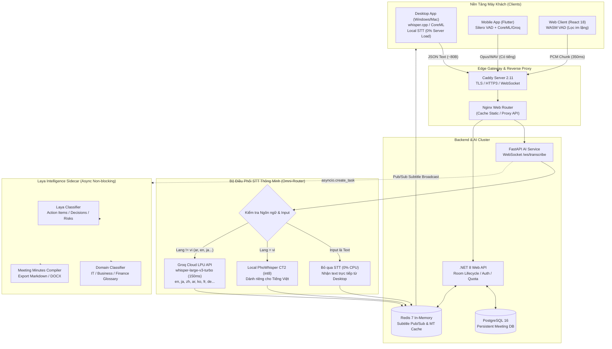

# 🏛️ MASTER BLUEPRINT: KIẾN TRÚC ĐIỀU PHỐI ĐA NGÔN NGỮ & HẠ TẦNG HIỆU NĂNG CAO LAYAMEET

> **Phiên bản:** 2.0-PRODUCTION-READY  
> **Dự án:** `AI-Translate-Meeting` (`layameet.com`)  
> **Mục tiêu quy mô:** 20–30 Phòng họp đồng thời / 500 CCU (Concurrent Users)  
> **Mục tiêu chi phí:** Cực rẻ (~$15–$25/tháng trên VPS 4 vCPU / 8GB RAM)  
> **Nguyên tắc kỹ thuật:** Strict Typing, Zero PII Logging, Non-blocking Audio Pipeline, Design System Token 3 Tầng.

---

## MỤC LỤC CHI TIẾT
1. [Bản Đồ Kiến Trúc Hệ Thống (Architecture Topology)](#1-bản-đồ-kiến-trúc-hệ-thống)
2. [Đặc Tả Phân Vai & Sứ Mệnh Laya AI (Executive Intelligence Sidecar)](#2-đặc-tả-phân-vai-laya-ai)
3. [Ma Trận Điều Phối Thông Minh Toàn Cầu (Omni-Language STT & MT Matrix)](#3-ma-trận-điều-phối-đa-ngôn-ngữ)
4. [Cơ Chế Client-Aware Offloading (Desktop vs Mobile vs Web)](#4-cơ-chế-client-aware-offloading)
5. [Đặc Tả Giao Thức WebSocket & Data Contract (RFC-Compliant)](#5-đặc-tả-giao-thức-websocket)
6. [Design System & Hỗ Trợ Đa Ngữ RTL (Arabic, Hebrew, Persian)](#6-design-system--rtl-support)
7. [Lộ Trình Triển Khai Chi Tiết Từng Sprint (Step-by-Step Task Breakdown)](#7-lộ-trình-triển-khai-từng-sprint)
8. [Bộ Kiểm Thử & Tiêu Chí Nghiệm Thu (Strict Verification Suite)](#8-tiêu-chí-nghiệm-thu--kiểm-thử)

---

## 1. BẢN ĐỒ KIẾN TRÚC HỆ THỐNG



---

## 2. ĐẶC TẢ PHÂN VAI LAYA AI

> [!IMPORTANT]
> **Quy tắc bất biến:** Laya AI tuyệt đối **KHÔNG** tham gia vào đường truyền phụ đề thời gian thực (Critical Path). Toàn bộ tác vụ của Laya chạy trong background task không đồng bộ (`asyncio.create_task`). Nếu Laya AI bị timeout hoặc gặp sự cố, luồng phụ đề chính vẫn phải chạy mượt mà dưới 350ms.

| Vai trò | Cơ chế thực thi | Dữ liệu đầu vào | Kết quả đầu ra |
| :--- | :--- | :--- | :--- |
| **1. Decision & Action Item Extractor** | Phân loại ngữ nghĩa Zero-shot (Noul questions) | Dòng phụ đề cuối cùng (`isFinal=True`) | Gắn cờ: `action_item`, `decision_made`, `unanswered_question`, `critical_risk`. |
| **2. Dynamic Context & Glossary Guiding** | Phát hiện chủ đề cuộc họp | 5–10 câu thoại gần nhất | Tự động kích hoạt bộ từ điển: `it_software`, `business_contract`, `finance` đưa vào Cache. |
| **3. Automated Meeting Minutes** | Gom cụm và biên tập khi đóng phòng | Toàn bộ log hội thoại đã khử filler words | File biên bản cuộc họp: Executive Summary, Decisions, Action Items có người phụ trách và hạn chót. |
| **4. Real-time Risk Watchdog** | Regex + Phân loại rủi ro nghiêm trọng | Phát biểu của người tham gia | Cảnh báo lên thanh trạng thái: *Sự cố hạ tầng, Lỗ hổng bảo mật, Vi phạm SLA*. |

---

## 3. MA TRẬN ĐIỀU PHỐI ĐA NGÔN NGỮ (OMNI-LANGUAGE STT & MT)

Hệ thống tự động lựa chọn Engine nhận dạng và mô hình dịch theo ngôn ngữ nguồn và ngôn ngữ đích:

```
                            ┌────────────────────────────────────────┐
                            │    XÁC ĐỊNH MÔ HÌNH THEO NGÔN NGỮ      │
                            └────────────────────────────────────────┘
                                                 │
        ┌────────────────────────────────────────┼────────────────────────────────────────┐
        ▼                                        ▼                                        ▼
  [TIẾNG VIỆT (vi)]                  [QUỐC TẾ (en, ja, zh, ko...)]              [Ả RẬP & TRUNG ĐÔNG (ar)]
        │                                        │                                        │
• STT: Local PhoWhisper CT2          • STT: Groq whisper-large-v3-turbo       • STT: Groq whisper-large-v3-turbo
• Nhẹ: 350MB RAM, chuẩn dấu          • Siêu tốc: 150ms, 0% CPU server         • Kèm Arabic Business Prompt
• Fallback: Groq + VI Prompt         • Fallback: Local faster-whisper         • UI: Kích hoạt chế độ RTL
```

### Bảng Ma Trận Chi Tiết:

| Mã Ngôn Ngữ | Tên Ngôn Ngữ | STT Engine Cấp 1 (Chính) | STT Fallback (Dự phòng) | Translation Engine Ưu Tiên | Prompt Khởi Tạo (Initial Prompt) |
| :---: | :--- | :--- | :--- | :--- | :--- |
| `vi` | Tiếng Việt | **Local PhoWhisper CT2** | Groq L3 Turbo + VI Prompt | Local Contextual + Glossary | `"Cuộc họp trực tuyến: kế hoạch, dự án, triển khai, sprint, bug, deploy."` |
| `en` | Tiếng Anh | **Groq L3 Turbo** | Local faster-whisper | Qwen-MT / DeepSeek | `"Online meeting: roadmap, deliverables, milestones, architecture."` |
| `ja` | Tiếng Nhật | **Groq L3 Turbo** | Local faster-whisper | Qwen-MT (Keigo Context) | `"オンライン会議、プロジェクト進捗、仕様書、納期、確認事項。"` |
| `zh` | Tiếng Trung | **Groq L3 Turbo** | Local faster-whisper | Qwen-MT-Turbo | `"在线会议：项目进展、系统架构、排期、问题复盘。"` |
| `ar` | Tiếng Ả Rập | **Groq L3 Turbo** | Local faster-whisper Large | Qwen-MT-Turbo (RTL) | `"اجتماع عمل رسمي عبر الإنترنت، مناقشة المشاريع، التقرير، خطة العمل."` |
| `ko` | Tiếng Hàn | **Groq L3 Turbo** | Local faster-whisper | Qwen-MT / DeepSeek | `"온라인 미팅: 스프린트, 개발 일정, 배포, 이슈 공유."` |
| `fr` / `de` / `es` | Châu Âu | **Groq L3 Turbo** | Local faster-whisper | Local Contextual / Qwen | Tương ứng theo chuẩn ngôn ngữ quốc tế. |

---

## 4. CƠ CHẾ CLIENT-AWARE OFFLOADING

Nhằm đảm bảo **1 VPS 4 vCPU ($15/tháng)** phục vụ 20–30 phòng (500 CCU), hệ thống phân phối nhiệm vụ theo từng loại thiết bị:

| Thiết bị | Khả năng tính toán của Client | Định dạng truyền tải qua WebSocket | Tải áp lực lên Server |
| :--- | :--- | :--- | :---: |
| **Desktop App (Windows / macOS)** | • Chạy `whisper.cpp` (DirectML trên Windows, CoreML/ANE trên Mac).<br>• Tự phiên âm âm thanh thành text trên máy. | Gửi bản tin JSON: `client_transcript` (chứa text, sourceLang, isFinal). Dung lượng ~80 bytes. | **0% CPU STT**<br>(Giảm 98% băng thông) |
| **Mobile App (Flutter iOS/Android)** | • Chạy Silero VAD nén audio.<br>• Trên iPhone: model whisper-tiny CoreML.<br>• Trên Android: Stream audio khi có tiếng nói. | Gửi audio chunk nén Opus (hoặc JSON text trên iOS). | **Rất thấp**<br>(Tự ngắt mic khi im lặng) |
| **Web Browser (Chrome/Safari)** | • WebAssembly Silero VAD trong AudioWorklet.<br>• Khi im lặng: Chặn 100% audio gửi lên server. | Chỉ stream chunk 350ms PCM khi phát hiện có tiếng nói. | **~5% CPU**<br>(Được chuyển sang Groq LPU) |

---

## 5. ĐẶC TẢ GIAO THỨC WEBSOCKET & DATA CONTRACT

Endpoint: `wss://layameet.com/ws/transcribe?meetingId={meetingId}&participantId={participantId}`

### 5.1. Authentication Frame (Khởi tạo kết nối)
```json
{
  "type": "authenticate",
  "token": "eyJhbGciOiJIUzI1NiIsIn...",
  "participantName": "Hieu Du",
  "sourceLanguage": "vi",
  "targetLanguage": "ar",
  "clientType": "desktop",
  "sttCapability": "local_whisper_cpp"
}
```

### 5.2. Frame Nhận Từ Client
* **Trường hợp 1 (Client tự chạy STT - Desktop):**
```json
{
  "type": "client_transcript",
  "text": "Dự án đã sẵn sàng triển khai",
  "sourceLanguage": "vi",
  "isFinal": true,
  "confidence": 0.98
}
```
* **Trường hợp 2 (Client stream âm thanh - Web/Mobile):**
  - Truyền dữ liệu nhị phân: `Binary Frame` (PCM 16-bit 16kHz mono, dung lượng 11.200 bytes cho chunk 350ms).

### 5.3. Frame Phụ Đề Broadcast Từ Server Tới Tất Cả Thành Viên
```json
{
  "type": "subtitle",
  "data": {
    "subtitleId": "sub_9f82d1",
    "meetingId": "62f630d9-...",
    "speakerId": "p_2114fd...",
    "speakerName": "Hieu Du",
    "sourceLanguage": "vi",
    "targetLanguage": "ar",
    "originalText": "Dự án đã sẵn sàng triển khai",
    "translatedText": "المشروع جاهز للنشر",
    "direction": "rtl",
    "isFinal": true,
    "confidence": 0.96,
    "latencyMs": 142.5,
    "layaMetadata": {
      "isActionItem": false,
      "isDecision": true,
      "topic": "it_software"
    }
  }
}
```

---

## 6. DESIGN SYSTEM & RTL SUPPORT (SLATE PRO TOKEN)

Toàn bộ giao diện hiển thị phụ đề và bảng điều khiển tuân thủ chuẩn kiến trúc Token 3 Tầng (`/design-system`):

### 6.1. Token Biểu Diễn Trạng Thái & Hướng Đọc (RTL / LTR)

```css
/* Level 1: Primitive Tokens */
--color-slate-950: #0b0f17;
--color-slate-900: #111827;
--color-blue-500:  #3b82f6;
--color-emerald-500: #10b981;
--font-sans: 'Inter', -apple-system, sans-serif;
--font-arabic: 'IBM Plex Sans Arabic', 'Noto Sans Arabic', sans-serif;

/* Level 2: Semantic Tokens */
--surface-bubble-bg: rgba(17, 24, 39, 0.85);
--surface-bubble-border: rgba(255, 255, 255, 0.1);
--text-bubble-orig: #f8fafc;
--text-bubble-trans: #60a5fa;

/* Level 3: Component RTL/LTR Modifiers */
.subtitle-bubble[data-dir="rtl"] {
  direction: rtl;
  text-align: right;
  font-family: var(--font-arabic);
}

.subtitle-bubble[data-dir="ltr"] {
  direction: ltr;
  text-align: left;
  font-family: var(--font-sans);
}
```

### 6.2. Component Specs: Subtitle Overlay Panel

| Trạng thái (State) | Chỉ báo hoạt động | Màu chữ gốc | Màu chữ dịch | Hiệu ứng viền | Hướng văn bản |
| :--- | :--- | :--- | :--- | :--- | :--- |
| **Interim (Đang nói)** | Chấm xanh nhấp nháy | Xám mờ (`#94a3b8`) | Xanh mờ (`#93c5fd`) | Viền đứt nét (`border-dashed`) | Tự động theo ngôn ngữ |
| **Final (Chốt câu)** | Cố định sáng rõ | Trắng (`#f8fafc`) | Xanh chuẩn (`#60a5fa`) | Viền liền (`border-solid`) | Tự động theo ngôn ngữ |
| **Decision Tagged** | Huy hiệu vàng (Laya) | Trắng | Xanh | Viền vàng ánh kim (`#eab308`) | Tự động theo ngôn ngữ |

---

## 7. LỘ TRÌNH TRIỂN KHAI TỪNG SPRINT (ACTIONABLE SPRINTS)

### 🏃 SPRINT 1: CORE SMART ROUTER & GROQ CLOUD LPU
* **Mục tiêu**: Xây dựng xong bộ điều phối STT, gọi Groq API cho các thứ tiếng quốc tế, giữ PhoWhisper cho tiếng Việt.
* **Tasks cụ thể**:
  1. `apps/ai-service/app/config/settings.py`: Thêm cấu hình `GROQ_API_KEY`, `STT_PROVIDER`, `GROQ_STT_MODEL`.
  2. Tạo mới `apps/ai-service/app/speech/groq_whisper_service.py`: Client `httpx` async kết nối `api.groq.com/openai/v1/audio/transcriptions`.
  3. Cập nhật `apps/ai-service/app/speech/whisper_service.py`: Tích hợp class `OmniLanguageRouter`:
     - Nếu `lang == 'vi'`: Gọi PhoWhisper CT2 nội bộ.
     - Nếu `lang != 'vi'`: Gọi Groq LPU API.
     - Fallback: Nếu Groq lỗi $\rightarrow$ fallback Faster-Whisper CPU; nếu PhoWhisper lỗi $\rightarrow$ fallback Groq + Vietnamese initial prompt.
  4. Viết unit test: `apps/ai-service/tests/test_groq_stt_provider.py`.

---

### 🏃 SPRINT 2: MA TRẬN ĐA NGỮ, DIALECT PROMPTING & HỖ TRỢ Ả RẬP RTL
* **Mục tiêu**: Tối ưu chất lượng tiếng Ả Rập, Nhật Bản, Trung Quốc và render chuẩn giao diện RTL trên Frontend.
* **Tasks cụ thể**:
  1. Thêm bộ từ điển `CULTURAL_INITIAL_PROMPTS` trong `whisper_service.py` cho `ar`, `ja`, `zh`.
  2. Cập nhật `apps/web/src/components/subtitle/SubtitleOverlay.tsx` và `SubtitlePanel.tsx`:
     - Đọc trường `direction: "rtl" | "ltr"` từ WebSocket payload.
     - Tự động gắn thuộc tính `dir={data.direction}` và class typography tiếng Ả Rập.
  3. Kiểm tra cặp dịch đa ngữ `ar <-> vi`, `ar <-> en` thông qua `qwen-mt-turbo` fallback.

---

### 🏃 SPRINT 3: CLIENT OFFLOADING & GIAO THỨC HYBRID WEBSOCKET
* **Mục tiêu**: Hỗ trợ Desktop Client gửi thẳng text (0% CPU STT trên server), Web Client chạy VAD WebAssembly.
* **Tasks cụ thể**:
  1. Cập nhật `apps/ai-service/app/websocket/transcribe_handler.py`:
     - Nhận diện message `type: "client_transcript"`.
     - Bỏ qua hoàn toàn STT, đưa thẳng payload vào pipeline dịch và Laya Sidecar.
  2. Frontend React `useAudioStream.ts`: Tích hợp bộ đệm Silero VAD (WASM), ngắt stream binary frame khi im lặng.
  3. Đảm bảo zero cross-room leakage khi vừa có client gửi text vừa có client gửi audio.

---

### 🏃 SPRINT 4: TỐI ƯU HẠ TẦNG, QUOTA & BENCHMARKING TẢI CAO
* **Mục tiêu**: Nâng trần hệ thống lên 25 phòng / 50 người/phòng và xác minh hiệu năng thực tế.
* **Tasks cụ thể**:
  1. Cập nhật `.env.production` và `docker-compose.production.yml` cấu hình `DEFAULT_MAX_ROOMS=25`.
  2. Cập nhật kịch bản kiểm thử tải `scripts/load-test.py` mô phỏng đồng thời:
     - 5 phòng nói tiếng Việt (chạy PhoWhisper).
     - 10 phòng nói tiếng Anh/Nhật/Trung (chạy Groq).
     - 5 phòng nói tiếng Ả Rập (chạy Groq + RTL).
  3. Đo lường TTFS latency (Time-to-first-subtitle) đảm bảo duy trì **< 250ms**.

---

## 8. TIÊU CHÍ NGHIỆM THU & KIỂM THỬ (VERIFICATION GATES)

Mọi thay đổi trước khi release bắt buộc phải thỏa mãn 4 điều kiện kỹ thuật:

```bash
# Cổng 1: Toàn bộ kiểm thử đơn vị & hợp đồng Python vượt qua 100%
python -m pytest apps/ai-service/tests/ -v
python -m pytest tests/ -v

# Cổng 2: Toàn bộ kiểm thử .NET API vượt qua 100%
dotnet test tests/AITranslateMeeting.Api.Tests/AITranslateMeeting.Api.Tests.csproj

# Cổng 3: Frontend Lint & Production Build không có lỗi TypeScript / Bundle
cd apps/web && npm run build

# Cổng 4: Kịch bản kiểm thử tải tổng hợp
python scripts/load-test.py --api-url https://layameet.com --ws-url wss://layameet.com --rooms 3 --participants-per-room 5
```

> [!TIP]
> **Cam kết hiệu năng:**
> - TTFS Median (p50): $\le 250\text{ms}$.
> - Tỷ lệ lỗi Server (5xx): **0%**.
> - Mức tiêu thụ CPU của VPS khi 20 phòng cùng hoạt động: $\le 35\%$.
