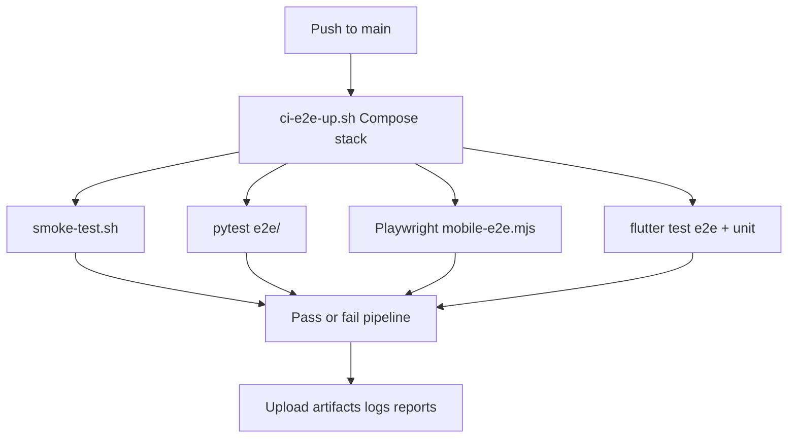

# Laya Meet — Production E2E Matrix

Automated end-to-end coverage for the **full monorepo** (Web + API + AI + Mobile), designed to run on every push to `main` via GitHub Actions.

## Triggers

| Event | Workflow |
|-------|----------|
| `push` to `main` / `master` | `.github/workflows/e2e-production.yml` |
| Manual | Actions → **E2E Production** → Run workflow |

Unit/lint CI remains in `.github/workflows/ci.yml` (PR + push).

## Architecture



## Stack under test

Compose files:

- [`docker-compose.yml`](../../docker-compose.yml) — full services
- [`docker-compose.e2e.yml`](../../docker-compose.e2e.yml) — CI overlay (tiny Whisper, Laya off)
- [`.env.ci`](../../.env.ci) — CI secrets (not for production deploy)

Services: Postgres, Redis, LiveKit, API, AI (Whisper tiny), Web.

## Test suites

### 1. Smoke (ops / security)

`scripts/smoke-test.sh`

- Web HTTP 200
- API live/ready
- AI live/ready
- System status / glossary / license / audit / cleanup
- Create meeting + invite + join (LiveKit + subtitle JWTs)
- WSS handshake probes, security headers, LiveKit ports

### 2. API + AI E2E (pytest)

`e2e/`

| File | Coverage |
|------|----------|
| `test_stack_health_e2e.py` | Health + system status |
| `test_meeting_lifecycle_e2e.py` | Create / get / leave / ProblemDetails |
| `test_subtitle_ws_e2e.py` | Authenticated `/ws/transcribe` |

Run locally (stack up):

```bash
pip install requests pytest pytest-asyncio websockets
pytest e2e/ -v -m e2e
```

### 3. Web E2E (Playwright — real browser + live stack)

`apps/web/scripts/mobile-e2e.mjs` (existing production-grade script)

CI runs **Chromium Pixel 7** profile against `http://localhost:3000`:

- Create meeting → prejoin → join LiveKit room
- Mic/camera toggles, captions, people, chat, tools
- Offline/online, leave + minutes export
- JA locale + home sections + settings tabs
- axe-core WCAG audits

```bash
cd apps/web && npm ci
MOBILE_BASE_URL=http://localhost:3000 MOBILE_DEVICE=pixel7-chromium npm run test:e2e:ci
```

### 4. Mobile Flutter E2E

| Suite | Path | Notes |
|-------|------|-------|
| Widget E2E | `apps/mobile/test/e2e/full_app_flow_test.dart` | Full UI flow with fakes (CI) |
| Device E2E | `apps/mobile/integration_test/app_e2e_test.dart` | Emulator; `E2E_LIVE=1` hits real API |

LiveKit media + subtitle socket are faked in mobile UI E2E so CI stays deterministic; **API join tokens are real** when `E2E_LIVE=1`.

```bash
cd apps/mobile
flutter test test/e2e/
flutter test integration_test/ -d emulator-5554 \
  --dart-define=E2E_LIVE=1 \
  --dart-define=API_BASE_URL=http://10.0.2.2:5000
```

## Artifacts (on failure / always)

- Compose logs
- Playwright `results.json`, screenshots, traces
- Pytest JUnit XML
- Flutter test logs

## Local full gate

```bash
chmod +x scripts/ci-e2e-up.sh scripts/ci-e2e-down.sh scripts/smoke-test.sh
./scripts/ci-e2e-up.sh
./scripts/smoke-test.sh
pytest e2e/ -v -m e2e
cd apps/web && MOBILE_BASE_URL=http://localhost:3000 MOBILE_DEVICE=pixel7-chromium npm run test:e2e:ci
cd ../mobile && flutter test && flutter test test/e2e/
./scripts/ci-e2e-down.sh
```

## Production notes

1. This gate validates the **compose stack built from the commit**, not the public SaaS URL (unless you override `E2E_*_URL` / `MOBILE_BASE_URL`).
2. For staging domain rehearsal use `scripts/smoke-test.sh --domain staging.example.com --insecure`.
3. Never commit real production keystores or SaaS API keys into `.env.ci`.
