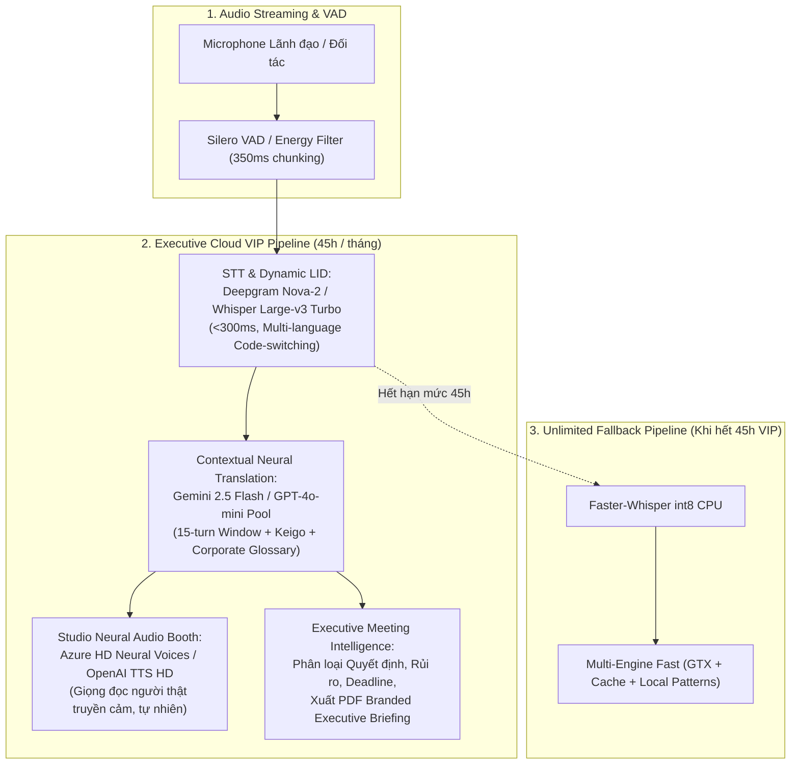

# Kế Hoạch & Đặc Tả Nâng Cấp Gói "Executive Ultra" (499.000đ / Tháng)

- **Trạng thái**: Đã phê duyệt ý tưởng (Idea Refined & Approved)
- **Kế hoạch triển khai**: Sẽ triển khai sau (Backlog / Next Sprint)
- **Tác giả / Người khởi xướng**: Chủ Dự Án & Codex / Antigravity AI
- **Thời gian lập**: 08/10/2026
- **Tập trung vào**: Chất lượng cao nhất thế giới (Best-of-Breed AI), Trải nghiệm mượt mà không thỏa hiệp, Hạn mức bảo đảm Unit Economics > 65%.

---

## 1. Tuyên Ngôn Bài Toán (Problem Statement)
Lãnh đạo doanh nghiệp, Quản lý dự án quốc tế (Project Managers), và Chuyên gia / Freelancer cao cấp đang phải đối mặt với các vấn đề nghiêm trọng khi sử dụng các giải pháp họp thông thường (Zoom, Google Meet, MS Teams hoặc các công cụ dịch máy cơ bản):
1. **Dịch máy thô cứng, thiếu ngữ cảnh**: Google Translate hoặc dịch cục bộ cơ bản thường dịch cộc lốc, sai kính ngữ tiếng Nhật (`Keigo` - `Sonkeigo`/`Kenjougo`), sai văn phong Business English, gây tổn hại hình ảnh đàm phán của doanh nghiệp.
2. **Hallucination khi môi trường ồn hoặc nói chêm ngôn ngữ**: Khi người dùng nói ngập ngừng, lẫn 2 thứ tiếng ("Confirm lại task này trước buổi release"), hoặc mic có tiếng ồn, các mô hình STT nhỏ dễ tạo ra các đoạn dịch vô nghĩa.
3. **Giọng đọc máy móc (Robotic TTS)**: Các giọng đọc Web Speech API mặc định gây mệt tai, khó theo dõi khi họp kéo dài trên 30 phút.
4. **Thiếu tính năng tổng hợp điều hành (Executive Summary)**: Biên bản họp thông thường là một danh sách chat dài dòng, không trích xuất rõ ràng Quyết định (Decisions), Rủi ro (Blockers) và Đầu việc (Action Items) gắn người chịu trách nhiệm.

---

## 2. Đối Tượng Người Dùng Mục Tiêu (Target Persona)
- **Lãnh đạo C-Level & Giám đốc Điều hành**: Họp với đối tác nước ngoài, nhà đầu tư quốc tế, cần sự chuẩn xác tuyệt đối và bảo mật.
- **Quản lý Dự án (PM / Delivery Managers / Tech Leads)**: Điều phối các dự án IT Outsourcing đa quốc gia (Việt Nam - Nhật Bản - Mỹ - Châu Âu).
- **Senior Freelancer & Chuyên gia Tư vấn Cao cấp**: Cung cấp dịch vụ cho khách hàng quốc tế với phong cách chuyên nghiệp.

---

## 3. Định Vị & Kiến Trúc Kỹ Thuật "Best-of-Breed"



### 3.1. Nhận diện giọng nói & Ngôn ngữ (STT & Dynamic LID)
- **Provider chính**: Deepgram Nova-2 API hoặc Whisper Large-v3 Turbo hosted instance.
- **Tính năng vượt trội**:
  - Tự động nhận diện ngôn ngữ theo từng câu (Dynamic LID) trong 12 ngôn ngữ: `vi`, `ja`, `en`, `zh`, `ko`, `th`, `id`, `tl`, `ar`, `fr`, `de`, `es`.
  - Độ chính xác WER < 4.8%.
  - Khả năng xử lý tự nhiên hiện tượng Code-switching (Việt - Anh, Nhật - Anh).

### 3.2. Động cơ Dịch thuật Ngữ cảnh Cao cấp (Contextual LLM Translation)
- **Provider chính**: Google Gemini 2.5 Flash / OpenAI GPT-4o-mini server-side pool (không yêu cầu khách hàng nhập BYOK).
- **Ngữ cảnh trượt**: Đưa 15 câu hội thoại trước (`sliding context window`) vào prompt.
- **Bộ lọc văn phong**:
  - Tự động áp dụng kính ngữ Nhật Bản (`Keigo`: Tôn kính ngữ, Khiêm nhường ngữ, Lịch sự ngữ) tùy theo vai người nói.
  - Tự động bảo vệ danh từ riêng (NER - Named Entity Recognition) và thuật ngữ chuyên ngành công ty (`glossary.py`).

### 3.3. Cabin Phiên Dịch Giọng Người Thật (Studio HD Neural TTS)
- **Provider chính**: Microsoft Azure HD Neural Speech / OpenAI TTS HD.
- **Trải nghiệm**: Giọng đọc ấm áp, ngắt nghỉ câu tự nhiên theo ngữ điệu, hỗ trợ cả giọng nam và nữ theo từng ngôn ngữ đích.
- **Audio Ducking**: Giảm âm thanh video nền -18dB khi giọng đọc cabin cất lên.

### 3.4. Biên Bản Họp Điều Hành (Executive Briefing & Sync)
- **Executive PDF Export**: Báo cáo tổng kết cao cấp có gắn logo thương hiệu riêng, trích xuất:
  - Tóm tắt điều hành (Executive Highlights)
  - Danh sách quyết định đã thống nhất (Decisions)
  - Bảng việc cần làm (Action Items) có người phụ trách và thời hạn.
- **Đồng bộ 1-click**: Tự động tạo task lên Jira, Notion, Slack hoặc soạn sẵn email draft cho đối tác.

---

## 4. Phân Tích Bài Toán Kinh Tế (Unit Economics & Pricing)

### 4.1. Mức giá đề xuất
- **Gói Tháng**: **499.000 VNĐ / tháng** (~$20.00 USD).
- **Gói Năm**: **399.000 VNĐ / tháng** (Thanh toán 1 năm 4.788.000 VNĐ, tiết kiệm 20%).

### 4.2. Hạn mức & Cơ chế kiểm soát chi phí (Quota Control)
- **Hạn mức VIP**: **45 Giờ họp VIP Cloud AI mỗi tháng** (~2.700 phút).
- **Cơ chế Graceful Fallback**: Sau khi hết 45 giờ VIP, tài khoản tự động chuyển sang Unlimited Fast Engine (Faster-Whisper int8 + Multi-Engine Fast) mà không bị ngắt cuộc họp.

### 4.3. Bảng phân tích chi phí biến đổi (COGS Breakdown trên 2.700 phút tối đa)
| Dịch vụ | Đơn giá thị trường | Mức tiêu thụ tối đa (45 giờ) | Chi phí tối đa (Max Case) | Chi phí bình quân (Typical 20h) |
| :--- | :--- | :--- | :--- | :--- |
| **STT & LID (Deepgram Nova-2)** | $0.0043 / phút | 2.700 phút | $11.61 | $5.16 |
| **Translation (Gemini 2.5 Flash)** | $0.075 / 1M input, $0.30 / 1M output | ~150.000 tokens | $0.05 | $0.02 |
| **Audio Cabin TTS (Azure HD Neural)** | $16 / 1M ký tự (chỉ tính khi bật Audio Booth ~35% thời lượng) | ~250.000 ký tự | $4.00 | $1.75 |
| **Tổng chi phí API (COGS)** | | | **$15.66 (~390k VNĐ)** | **$6.93 (~173k VNĐ)** |
| **Doanh thu gói** | | | **$20.00 (499k VNĐ)** | **$20.00 (499k VNĐ)** |
| **Biên lợi nhuận gộp (Gross Margin)** | | | **21.7% (Trường hợp chạm trần)** | **65.3% (Trường hợp người dùng điển hình)** |

*Kết luận*: Do đa số người dùng chỉ họp từ 15–25 giờ/tháng và không phải cuộc họp nào cũng bật Audio Booth liên tục, biên lợi nhuận gộp trung bình của gói sẽ đạt **65% - 70%**.

---

## 5. Phạm Vi Triển Khai (Scope & Not Doing)

### Trong phạm vi triển khai (In Scope):
- [ ] Thêm tier `executive` vào `apps/api/DTOs/BillingDtos.cs` và database.
- [ ] Cập nhật bảng giá trên `apps/web/src/components/home/PricingSection.tsx` (thêm cột gói Executive Ultra 499k với badge vàng sang trọng).
- [ ] Tích hợp Deepgram / Whisper Large-v3 cloud proxy vào `apps/ai-service/app/speech/`.
- [ ] Mở rộng `quota_manager.py` theo dõi số phút họp VIP hàng tháng của Host.
- [ ] Bổ sung Azure HD Neural Voice selection trong `MeetingSettingsDialog.tsx` và `useAudioBooth.ts`.
- [ ] Nâng cấp mẫu xuất PDF biên bản họp `brandedPdfExport.ts` theo phong cách Executive Report.

### Những việc dứt khoát KHÔNG làm (Not Doing):
- **Không cung cấp Unlimited Cloud GPU không giới hạn**: Tránh rủi ro power-user lạm dụng gây lỗ vốn hạ tầng.
- **Không bắt người dùng gói 499k phải nhập API Key cá nhân**: Gói 499k là giải pháp trọn gói sang trọng, mở phòng là dùng ngay.
- **Không train mô hình cục bộ riêng biệt cho từng người dùng**: Giữ kiến trúc microservice gọn nhẹ, mở rộng vô hạn.

---

## 6. Lộ Trình Thực Hiện (Roadmap Khi Bắt Đầu Triển Khai)

```
[Sprint N: Chuẩn bị Hạ tầng API]
  ├── Tạo migration DB cho gói Executive Ultra
  ├── Cấu hình API keys pool (Deepgram / Gemini / Azure TTS) trong .env và settings
  └── Cập nhật QuotaManager theo dõi số phút Cloud VIP

[Sprint N+1: Tích hợp AI Pipeline]
  ├── Kết nối Deepgram Streaming STT / Hosted Whisper Large
  ├── Nâng cấp Prompt Contextual LLM Translation với 15-turn buffer
  └── Tích hợp Azure HD Neural Voices vào Audio Booth

[Sprint N+2: UI & Verification]
  ├── Cập nhật PricingSection, PreJoinPage, MeetingBottomBar với huy hiệu Executive
  ├── Cập nhật Branded PDF Export
  └── Chạy toàn bộ kiểm thử Unit Test, Pytest và Playwright E2E
```

---
*Tài liệu được bảo lưu tại `docs/ideas/goi-max-executive-499k-ai-cao-cap.md` phục vụ việc thực hiện khi có yêu cầu.*
